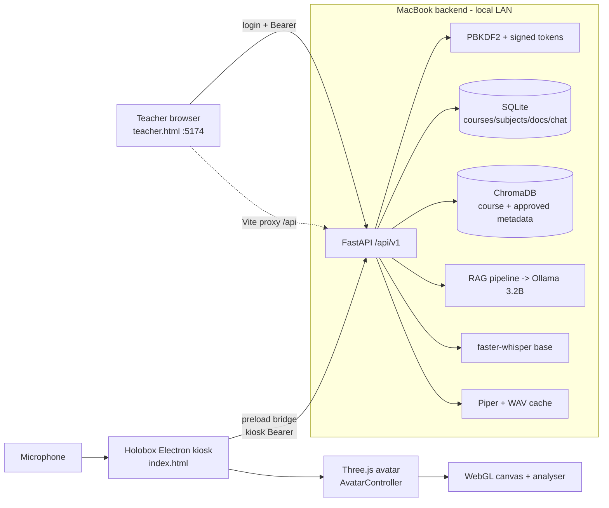

# Holobox College Project — Implementation Report

Date: 2026-11-24. Working tree at `~/Desktop/holobox-rag`.

## A. Executive summary

The project has been evolved from a single-user RAG assistant into the intended
**two-interface, one-backend** architecture:

- a browser-based **Teacher Admin Portal** for course/subject management and
  approved document ingestion;
- a fullscreen Electron **Student Holobox Kiosk** with a Three.js avatar, voice
  interaction, course selection and no administrative controls;
- one shared FastAPI backend owning authentication, courses, documents, RAG,
  embeddings, vector search, STT and TTS.

The existing RAG stack (MiniLM + ChromaDB + Ollama `llama3.2:latest`), Whisper,
Piper, SQLite and all prior tests were preserved; changes are additive apart from
removing teacher-only screens from the kiosk bundle. Password hashing, signed
bearer tokens, kiosk credentials and server-side course/approval filters were
added. The avatar was inspected before integration; it has no mouth controls, so
speaking uses an honest amplitude-driven fallback rather than fake lip sync.

## B. Final architecture

Data flow: teacher uploads → extract/chunk → embed → SQLite + ChromaDB (with
`course_id`, `subject_id`, `approved`) → kiosk selects course → mic audio →
Whisper → course-filtered retrieval → Ollama grounded answer → Piper WAV →
single audio element in kiosk → analyser drives avatar motion.

## C. Repository changes

**New backend files:** `app/core/auth.py`, `app/api/auth.py`, `app/api/courses.py`,
`scripts/hash_password.py`, `tests/test_rbac.py`.

**Modified backend files:** `config.py` (auth/course settings, production guards),
`schemas.py` (roles, courses, documents, login, query course fields),
`services/repository.py` (courses/subjects tables, forward-only document columns,
filtered listing), `ingestion/ingestor.py` (course metadata, `reindex`),
`vector_db/*` + `services/indexer.py` (course/subject/approved metadata),
`retrieval/retriever.py` and `rag/pipeline.py` (course/approval filters),
`api/documents.py` (teacher-only CRUD, reindex, replace, approve),
`api/query.py`, `api/voice.py`, `api/synthesis.py`, `api/conversations.py`
(token-derived identity), `main.py` (routers, schema seeding), `.env.example`,
and legacy tests adapted to role-based semantics.

**New frontend files:** `teacher.html`, `src/teacher/{main,TeacherApp,LoginPage,DocumentManager}.tsx`,
`src/teacher/teacher.css`, `src/kiosk/{KioskApp.tsx,kiosk.css}`,
`src/avatar/AvatarController.ts`, `src/components/Avatar.tsx`,
`src/hooks/useKioskConversation.ts`, `src/services/transport.ts`,
`public/avatar/sabrina_3d_avatar.glb`, `.env.example`.

**Removed from kiosk bundle:** old `App.tsx`, `pages/{Chat,History,KnowledgeBase,Settings}Page.tsx`,
`hooks/{useChat,useVoice}.ts` and their display components. They were the
administrative chat UI and would violate the student-only requirement.

**New dependencies:** npm `three@0.171.0`, `@types/three@0.171.0`. No new Python
packages. **Database:** additive migration only — `documents` gained
`course_id`, `subject_id`, `approved`, `uploader`, `updated_at`; new `courses` and
`subjects` tables; existing rows backfilled to `general` + approved.

**New API endpoints:** `/auth/login`, `/auth/me`, `/courses` (GET/POST),
`/courses/{id}/subjects` (GET/POST), `PATCH /documents/{id}`,
`POST /documents/{id}/reindex`, `POST /documents/{id}/replace`.

**Decisions:** single shared knowledge base with metadata filtering (no second
ChromaDB); role checks in FastAPI dependencies, never in the UI; Vite proxy for
the browser portal (no CORS dependency in dev); Electron main owns backend HTTP
and the kiosk credential.

## D. Teacher portal

Implemented: login with hashed password and signed token, logout, course list and
creation, subject list and creation, document upload with course/subject/approval
selection, document list with metadata (filename, subject, uploader, date,
status, chunks/pages), approval toggle, re-index, replace, delete, and visible
API error messages.

Limitations: no password-reset flow; no granular per-teacher course ACL (any
teacher can manage all courses — appropriate for the MVP demo); no upload progress
bar; no browser-based automated test harness (login/list verified manually via
Chrome DevTools Protocol).

## E. Student kiosk

Implemented: fullscreen Electron window; avatar-centred UI; course selector with
the current course always displayed; states idle / listening / processing /
speaking / error; microphone permission handling; stop-listening and
stop-answer controls; current question/answer and source names only (no personal
history); return to idle when audio ends or playback stops; retry after errors.
Document upload, deletion, settings, backend URLs and model controls are absent
from both the bundle and the UI; the backend independently returns 403 for kiosk
attempts at teacher operations.

Limitations: a physical Holobox PC and real room microphone were not available;
audio was verified through the Electron renderer with generated WAV data.

## F. Avatar inspection and integration

Full report: `docs/AVATAR_INSPECTION.md`. Summary:

| Property | Finding |
|---|---|
| File | `sabrina_3d_avatar.glb`, glTF 2.0 binary, 4.7 MB, CC-BY-4.0 (Poliko) |
| Meshes/materials | 8 meshes, 7 PBR materials, 11 embedded textures |
| Rig | 1 skin, 83 joints; head, neck, left/right eye bones; no jaw/mouth bones |
| Animation | one `Idle` clip, 22.33 s, 61 channels including head and neck |
| Morph targets | **none on any mesh**; no visemes |

Integration: `GLTFLoader`, `AnimationMixer` (Idle at 0.85×), auto-framed camera,
ambient/key/rim lights, `AvatarController` with detuned low-frequency idle head
motion, listening/attention posture, thinking tilt and happy/confused/neutral
head/eye variations.

**Lip sync:** no phoneme or jaw control exists. Speaking uses the real Piper WAV
through a Web Audio `AnalyserNode`; measured RMS drives subtle head nod and neck
motion while audio plays, plus an explicit on-screen speaking indicator. No face
mesh is displaced. This is **amplitude-driven speaking animation, not lip sync**.

Test results: GLB loaded in Electron with no error overlay, one WebGL canvas
present, idle status rendered, and a real Ollama answer's Piper WAV reported
`playing` from the renderer.

## G. Security

- Teacher passwords stored only as PBKDF2-SHA256 hashes (210k iterations); demo
  hash and random secrets live in gitignored `backend/.env`.
- Signed HMAC bearer tokens with expiry (8 h) for teachers; separate provisioned
  kiosk token. Role and identity come from the token, never the request body.
- All `/api/v1` routes require a token; document management requires `teacher`.
  Kiosk uploads/deletes/reindex/approve/replace returned 403 in live tests.
- Kiosk retrieval is filtered server-side to the requested **permitted** course,
  optional subject and `approved=1` documents before vector search. A kiosk
  query for another course returned 403; unapproved documents were excluded.
- CORS lists explicit origins; LAN mode is opt-in via `--host 0.0.0.0`; production
  config rejects auth-disabled mode, mock LLM, dev secrets and missing hash.
- Remaining limitations: one shared kiosk token per device (no per-student
  identity), no TLS, no rate limiting, no account lockout, no revocation list,
  and any teacher can manage every course. Suitable for a controlled LAN demo,
  not for public deployment.

## H. Deployment

Exact instructions and the LAN/Phase-2 distinction are in `docs/deployment.md`.
Short version: on the MacBook run Ollama, `uvicorn app.main:app --host 0.0.0.0
--port 8000`, and `npm run dev:teacher -- --host 0.0.0.0`; find the LAN IP with
`ipconfig getifaddr en0`; on the Windows PC set `HOLOBOX_BACKEND_URL`,
`HOLOBOX_KIOSK_TOKEN`, `HOLOBOX_KIOSK_COURSE`, run `npm run build &&
npm run electron:build && npm run electron`. The MacBook must remain running.
Windows execution and cross-device LAN traffic were **not** verified here.

## I. Testing report

| Test | Result | Command / procedure | Notes |
|---|---|---|---|
| Backend unit + integration suite | **PASS** | `cd backend && .venv/bin/python -m pytest tests -q` | 88 passed; includes new RBAC tests |
| Teacher login / invalid login | **PASS** | `tests/test_rbac.py` + live API | 200 with token; 401 `invalid_credentials` |
| Kiosk denied document management | **PASS** | `tests/test_rbac.py` + live API | upload/delete/reindex/patch/replace all 403 |
| Course-scoped + approval retrieval | **PASS** | `tests/test_rbac.py` + live API | other course 403; unapproved excluded |
| Document reindex / approve / replace | **PASS** | `tests/test_rbac.py` | associations preserved |
| Real upload + Ollama answer + citations | **PASS** | live API with `GPU_Project_Report.pdf` | `generation_mode=live`, 5 sources, correct Tesla T4 answer, no mock label |
| Unrelated question | **PASS** | live API | `no_relevant_context`, no fabrication |
| Whisper transcription | **PASS** | `tests/test_whisper.py` | real faster-whisper base |
| Piper WAV generation | **PASS** | `tests/test_piper.py` + live API | valid 22,050 Hz mono WAV, cached |
| Browser teacher login/list | **PASS** | Chrome DevTools Protocol on `:5174/teacher.html` | logged in as Teacher; 2 courses; GPU report listed |
| Kiosk build + avatar load | **PASS** | `npm run build`, `npm run electron:build`, Electron CDP | 1 canvas, no load error, idle status |
| Kiosk query + audio via bridge | **PASS** | Electron CDP | `mode=live`, 5 sources, 294,560-byte WAV reported `playing` |
| Frontend typecheck / contract check | **PASS** | `npm run build`, `npm run check:api-types` | generated types current |
| Windows build/run + cross-device LAN | **NOT RUN** | no Windows machine | documented only |
| Physical microphone on Holobox PC | **NOT RUN** | hardware unavailable | getUserMedia worked in dev environment |
| Phoneme lip sync | **BLOCKED by asset** | avatar inspection | no morphs/jaw; honest fallback implemented |

## J. Remaining work

**Essential before the college demo:** run on the actual Windows Holobox PC;
provision Windows Piper/faster-whisper assets if any inference is moved there
(current design keeps inference on the MacBook); configure the real LAN IP and
kiosk token; rotate the demo teacher password/secret; confirm WebGL and microphone
permissions on the kiosk; keep the MacBook awake and on the network.

**Optional improvements:** per-course teacher ACLs, token revocation, upload
progress, WebSocket token streaming for smoother avatar timing, a viseme-capable
avatar model (only `AvatarController` would change), browser E2E test harness.

## K. Recommended next steps

1. Run the LAN checklist in `docs/deployment.md` with both physical machines.
2. Rotate `HOLOBOX_TEACHER_PASSWORD_HASH`, `HOLOBOX_AUTH_SECRET` and
   `HOLOBOX_KIOSK_TOKEN` before anyone outside the project uses the system.
3. Upload the real course PDFs through the teacher portal and confirm the kiosk
   sees only approved documents for the selected course.
4. Verify microphone capture and audio output on the Holobox hardware.
5. If a lip-sync avatar is required, source a GLB with viseme morph targets and
   swap only `src/avatar/AvatarController.ts`.
